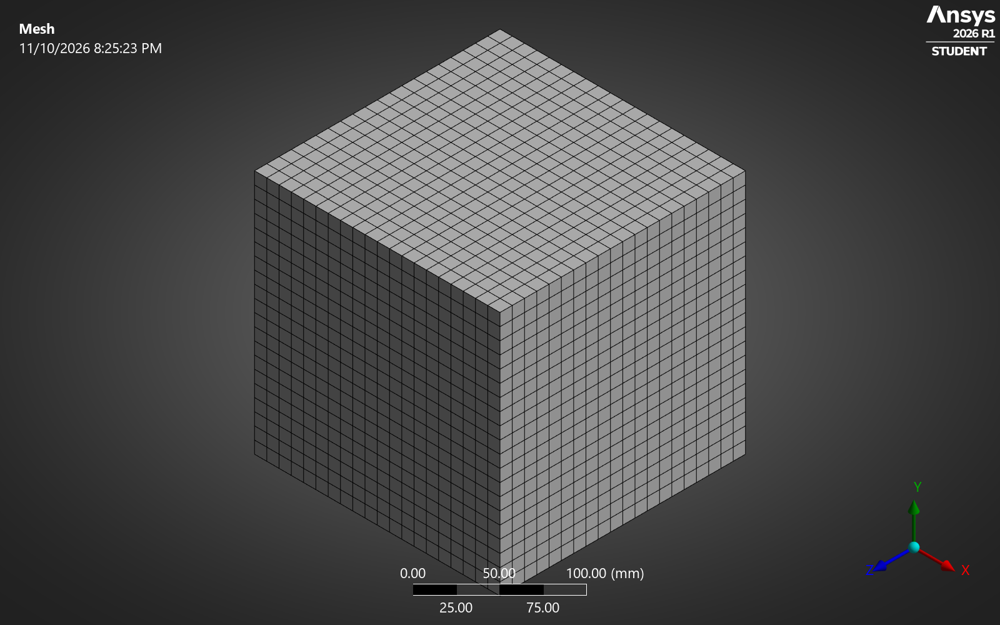
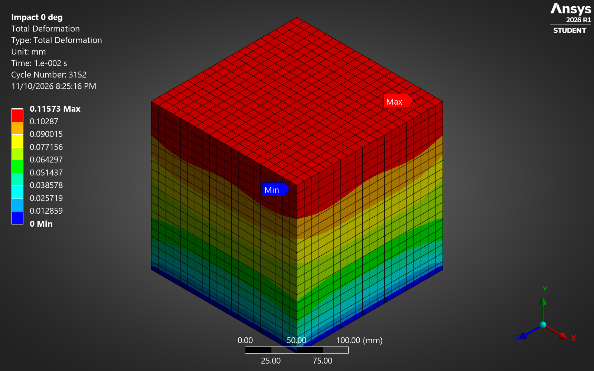
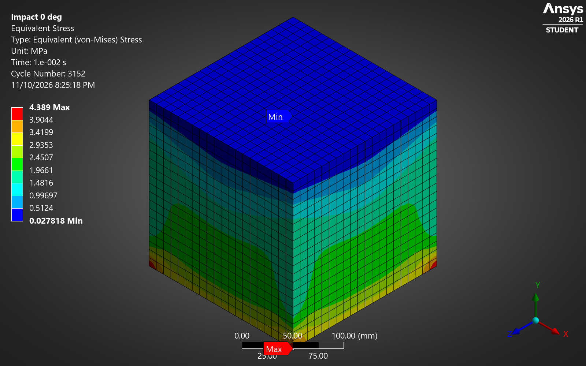
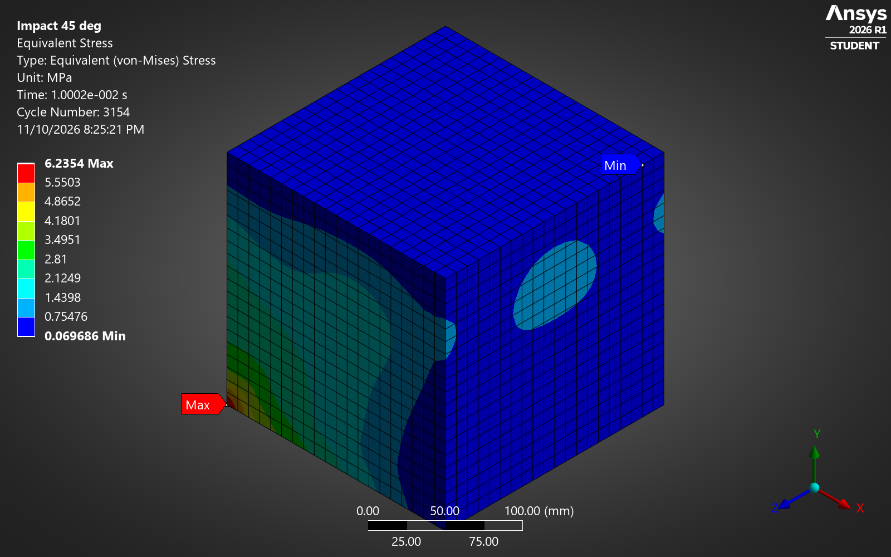

# Epoxy block under impact: 0° vs 45°

Same block, same speed, only the direction changes. In ANSYS Explicit Dynamics, the angled hit deforms the epoxy 2.3 times more than the head-on one.

**Tools:** ANSYS Mechanical 2026 R1 · Explicit Dynamics (AUTODYN)

## Overview

This was the first stage of a course study on self-healing polymer composites (2024, team of two). Before adding any healing agent, we wanted to see how the plain epoxy matrix reacts to a sudden load. I rebuilt the original setup in ANSYS Mechanical 2026 R1 (Student) in November 2026.

## Model setup

**Material: epoxy**

| Property | Value |
|---|---|
| Young's modulus | 3 GPa |
| Poisson's ratio | 0.35 |
| Density | 1200 kg/m³ |

**Setup**

- **Geometry:** 200 mm epoxy cube
- **Support:** bottom face (y = 0) fixed
- **Load:** initial velocity of 1.41 m/s on the whole block, either along y (0°) or at 45° in the x-y plane
- **Mesh:** 10 mm hex elements, 20 x 20 x 20 (8,000 elements, 9,261 nodes), physics preference set to Explicit
- **Solver:** Explicit Dynamics (AUTODYN), end time 10 ms, about 3,150 cycles

## Results

| Case | Initial velocity | Peak deformation | Peak von Mises stress | Hand check |
|---|---|---|---|---|
| 0° (head-on) | (0, 1.41, 0) m/s | 0.13 mm | 4.7 MPa | 0.14 mm |
| 45° | (1, 1, 0) m/s | 0.30 mm | 7.4 MPa | about 0.23 mm |

Peaks are the maximum over the whole 10 ms run. The contour images below show the state at 10 ms (0.116 mm and 0.258 mm).

| | Total deformation | Von Mises stress |
|---|---|---|
| **0°** |  |  |
| **45°** |  |  |

The 45° case has a sideways component that shears the block. In epoxy, shear waves travel at 962 m/s and compression waves at 2,003 m/s, so the block moves further before the reflected wave stops it. In both cases the stress peaks at the clamped base.

## Hand check

Using 1D wave theory, the top of the block moves a distance of v·L/c before the reflected wave stops it.

- **0°:** 1.414 x 0.2 / 2003 = 0.141 mm, against 0.129 mm from the FEA.
- **45°:** the compression part gives 0.100 mm and the shear part 0.208 mm, about 0.23 mm combined. The FEA gives 0.30 mm. Same direction and size; the real 3D block also bends, which the 1D estimate leaves out.

Wave speeds used: c = √(E/ρ) for compression and √(G/ρ) for shear, with G = E / 2(1 + ν).

## Files

| File | What it is |
|---|---|
| [ansys/epoxy_block_impact.mechdb](ansys/epoxy_block_impact.mechdb) | ANSYS Mechanical model (open in Mechanical 2026 R1) |
| [ansys/epoxy_material.xml](ansys/epoxy_material.xml) | Epoxy material data |
| [geometry/block_200mm.step](geometry/block_200mm.step) | Block geometry |
| [results/results.csv](results/results.csv) | Peak and final values for both cases |
| [media/](media/) | Mesh and contour plots |
| [media/ansys_walkthrough.mp4](media/ansys_walkthrough.mp4) | Screen recording of the setup and solve in ANSYS |

To download everything, use **Code → Download ZIP**.

---

Sai Phanidhar Ammiraju · [Portfolio](https://saiphani02.github.io/impact.html) · [LinkedIn](https://www.linkedin.com/in/sai-ammiraju)
