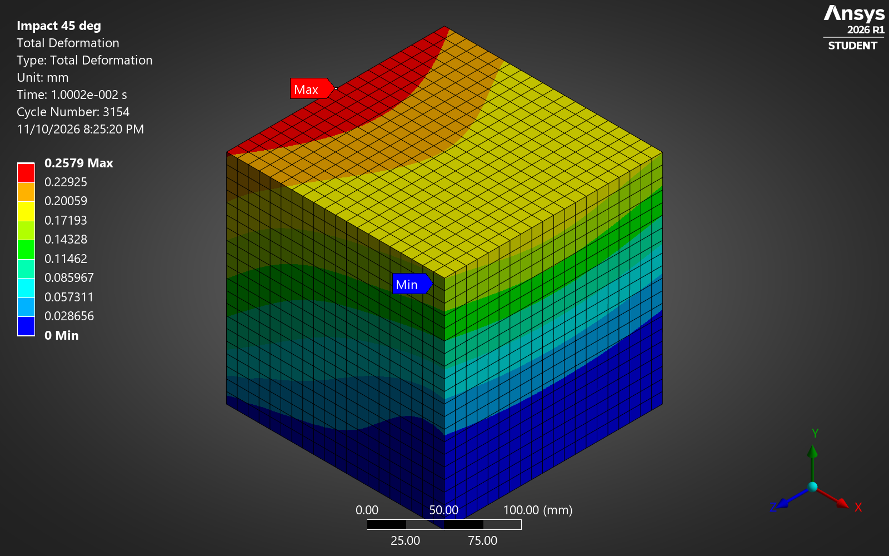

# Epoxy block under impact: 0° vs 45°

**Engineering tools:** ANSYS Mechanical 2026 R1 · Explicit Dynamics (AUTODYN) · STEP CAD geometry

## CAD and simulation deliverables

- [Native ANSYS Mechanical project](ansys/epoxy_block_impact.mechdb).
- [200 mm block CAD geometry (STEP)](geometry/block_200mm.step).
- [ANSYS setup and solution walkthrough](media/ansys_walkthrough.mp4).
- [Mesh image](media/mesh.png), [deformation contour](media/deg45_Total_Deformation.png), and [numerical results](results/results.json).

The engineering work covers material definition, hex meshing, fixed support, initial velocity, explicit solution, and comparison with wave-speed estimates. Python files support result export and analytical checks.

Same block, same speed, only the direction changes. The angled hit deforms the epoxy 2.3 times more than the head-on one.

This was the first stage of a course study on self-healing polymer composites (2024, team of 2): before adding any healing agent, see how the plain epoxy matrix reacts to a sudden load. The original setup was rebuilt by hand in ANSYS Mechanical 2026 R1 (Student) in November 2026, with AI assistance.



## Results

| Case | Initial velocity | Peak deformation | Peak von Mises stress | Hand check |
|---|---|---|---|---|
| 0° (head-on) | (0, 1.41, 0) m/s | 0.13 mm | 4.7 MPa | 0.14 mm |
| 45° | (1, 1, 0) m/s | 0.30 mm | 7.4 MPa | about 0.23 mm |

The peaks are taken over the whole 10 ms run. The images in `media/` show the state at 10 ms (0.116 mm and 0.258 mm).

The 45° case has a sideways part that shears the block. In epoxy, shear waves travel at 962 m/s and compression waves at 2,003 m/s, so the block moves further before the reflected wave stops it. The stress peaks at the clamped base in both cases.

## Model

- **Geometry:** 200 mm epoxy cube (`geometry/block_200mm.step`).
- **Material:** epoxy, with E = 3 GPa, ν = 0.35 and ρ = 1200 kg/m³ (`ansys/epoxy_material.xml`).
- **Support:** the bottom face (y = 0) is fixed.
- **Load:** the whole block gets an initial velocity of 1.41 m/s, either along y (0°) or at 45° in the x-y plane.
- **Solver:** ANSYS Explicit Dynamics (AUTODYN), end time 10 ms, about 3,150 cycles.
- **Mesh:** 10 mm hex mesh (20 × 20 × 20, 8,000 elements). The physics preference is Explicit, which gives the linear elements the solver requires.

## Checks

`hand_check/wave_check.py` uses 1D wave estimates. The top of the block moves v·L/c before the reflected wave stops it.

- **0°:** 1.414 × 0.2 / 2003 = 0.141 mm, against 0.129 mm from the FEA.
- **45°:** the compression part gives 0.100 mm and the shear part 0.208 mm, about 0.23 mm combined. The FEA gives 0.30 mm. Same direction and size; the 3D block also bends, which the 1D estimate leaves out.

## Files

```
ansys/       Mechanical project (.mechdb), material, result export script
geometry/    block STEP
results/     peak values (JSON)
media/       contour images, walkthrough video of the setup in Ansys
hand_check/  wave-speed estimates
```

`media/ansys_walkthrough.mp4` is a screen recording of the model being set up and solved by hand in the Ansys interface.

Sai Phanidhar Ammiraju · [Portfolio](https://saiphani02.github.io/impact.html) · [LinkedIn](https://www.linkedin.com/in/sai-ammiraju)
